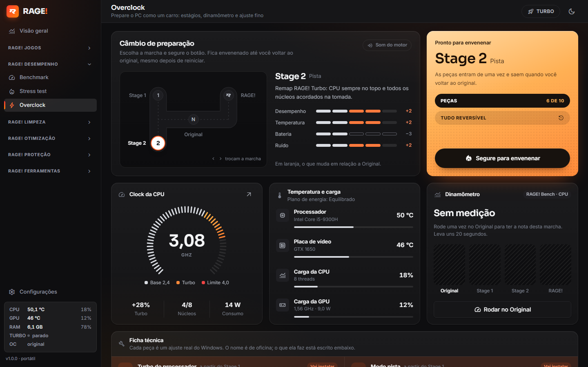
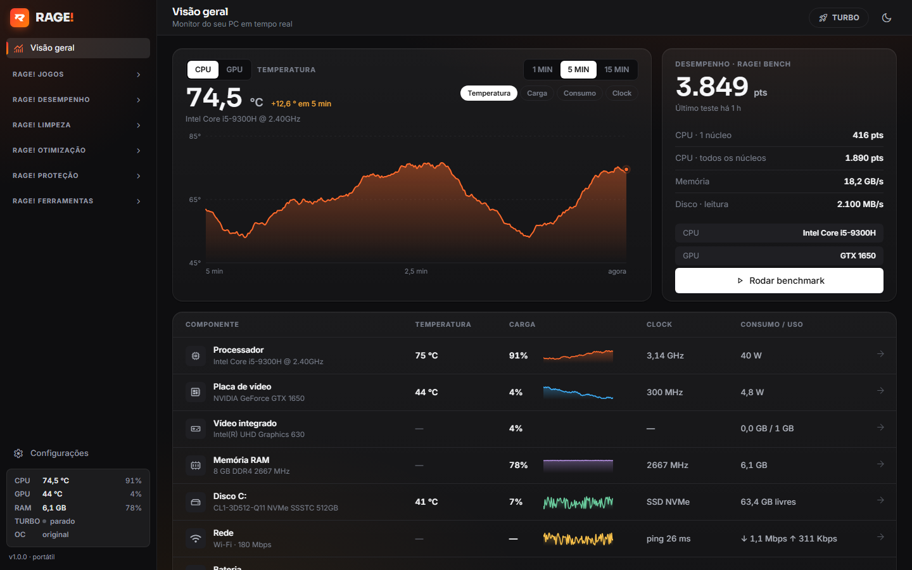
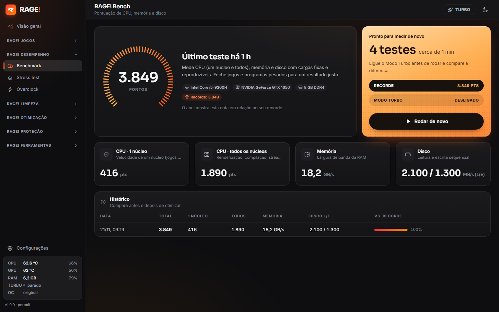
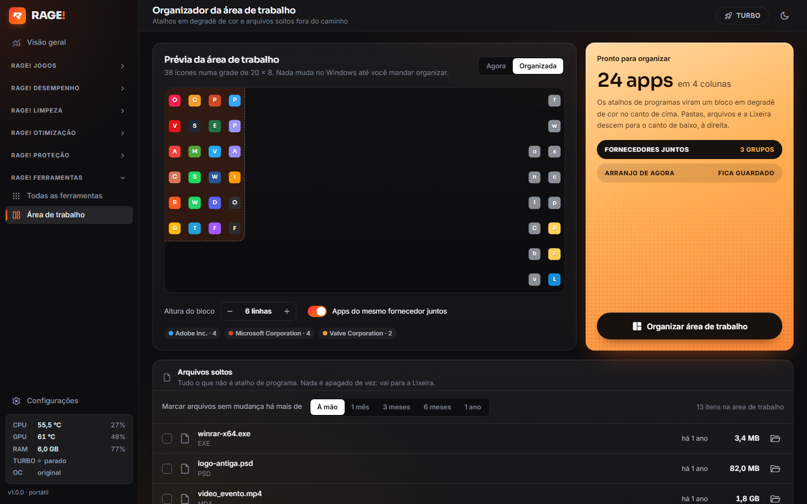

# RAGE!

Perfomance, cuidado e proteção para sua máquina.



O RAGE! junta num app só o que normalmente pede quatro ou cinco programas: ver temperatura e carga do PC em tempo real, limpar o que está sobrando, ajustar o Windows para jogar e medir se o ajuste fez diferença. Tudo o que ele muda no sistema pode ser desfeito pelo próprio app.

## Baixar e usar

1. Baixe o `RAGE-portatil.zip` na página de [Releases](../../releases/latest).
2. Extraia a pasta `RAGE!` onde quiser (Área de Trabalho, pendrive, outro HD).
3. Abra o `RAGE!.exe` e aceite o pedido de administrador.

Sem administrador ele abre em modo limitado: o monitor e a limpeza de RAM funcionam, o resto fica bloqueado.

O executável não tem assinatura digital, então o Windows mostra o aviso do SmartScreen na primeira vez. Clique em **Mais informações** e depois em **Executar assim mesmo**. Se o app não abrir depois de extrair, clique com o botão direito no zip, vá em **Propriedades**, marque **Desbloquear** e extraia de novo.

**Requisitos:** Windows 10 ou 11 de 64 bits. O .NET Framework 4.8 e o WebView2 já vêm no Windows 11; no Windows 10 costumam estar instalados, e o app avisa se o WebView2 faltar.

## Leia antes de usar

- O RAGE! roda como administrador e mexe em registro, serviços, plano de energia e arquivos temporários. Use por sua conta e risco.
- Esta é a primeira versão pública e foi testada em um único PC. O monitor e as telas foram bem exercitados; as partes que alteram o sistema, menos.
- Antes de limpar o registro ou aplicar correções, o app cria ponto de restauração e backup `.reg`. A tela **Resgate** desfaz o que foi feito.
- Alguns antivírus desconfiam de otimizadores em geral. O código está todo aqui para quem quiser conferir.
- Achou um problema? Abra uma [issue](../../issues) contando o que fez e o que aconteceu.

## O que ele faz

### Monitor em tempo real

Temperatura, carga, clock e consumo de CPU e GPU, uso de RAM e VRAM, disco, rede e bateria, com histórico de 15 minutos e alertas de temperatura.



A temperatura real do processador depende de um driver de sensores (PawnIO, gratuito e assinado). O app oferece a instalação em Configurações; sem ele, a temperatura da CPU aparece como indisponível.

### Jogos

- **Modo Turbo** com três perfis (Jogo, Trabalho, Economia): ativa um plano de energia próprio, pausa serviços que não fazem falta, fecha apps em segundo plano, libera RAM e dá prioridade ao jogo. Ao desligar, tudo volta como estava.
- **Turbo automático:** liga sozinho quando você abre um jogo e desliga quando fecha.
- **Biblioteca de jogos:** encontra jogos da Steam, Epic, Xbox, GOG, Ubisoft, Riot, EA e Battle.net, com opção de forçar a placa de vídeo dedicada por jogo.
- **Contador de FPS e overlay** durante a partida (`Ctrl+Shift+F10`).

### Desempenho

- **Overclock por marchas:** quatro estágios (Original, Stage 1, Stage 2 e RAGE!) que aplicam ajustes de energia do Windows cada vez mais agressivos. Não altera tensão, multiplicador nem BIOS, e uma "Ficha técnica" mostra o que cada ajuste faz de verdade.
- **Dinamômetro:** mede a CPU em cada estágio para mostrar o ganho real em relação ao original.
- **Benchmark:** nota de CPU (um núcleo e todos), memória e disco, com histórico para comparar antes e depois.
- **Stress test:** todos os núcleos em 100% para ver temperatura máxima e queda de clock. Para sozinho se a CPU passar de 98 °C.



### Limpeza

- **Verificação inteligente:** passa por lixo, privacidade, atalhos, registro, inicialização, ajustes, internet, segurança e disco de uma vez, e corrige o que você marcar.
- **Limpeza de lixo:** temporários, caches do Windows, de navegadores e de apps, Lixeira e rastros de uso.
- **Registro e atalhos:** entradas órfãs e atalhos que apontam para nada, sempre com backup.

### Otimização

- **Inicialização:** o que abre junto com o Windows e quanto pesa.
- **Ajustes do sistema:** jogos, desempenho e privacidade, um por um e reversíveis.
- **Internet:** ping, teste para achar o DNS mais rápido e ajustes de rede.
- **Disco:** saúde, TRIM e desfragmentação.

### Proteção

- **Antivírus:** controla o Microsoft Defender (estado, verificações e ameaças). O RAGE! não tem antivírus próprio.
- **Reforço de segurança:** brechas comuns do Windows, como execução automática de pendrives.
- **Resgate:** pontos de restauração e backups criados pelo app.

### Ferramentas

- **Organizador da área de trabalho:** arruma os atalhos de programas num bloco em degradê de cor, com apps do mesmo fornecedor lado a lado, e lista os arquivos soltos para mandar à Lixeira por tempo sem uso. Mostra uma prévia antes e guarda o arranjo anterior para desfazer.
- Processos, desinstalar programas, atualizar programas pelo winget, drivers, arquivos grandes, duplicados, pastas vazias, triturador de arquivos, informações do sistema, reparos do Windows (SFC, DISM, rede) e desligamento agendado.



## Privacidade

Não tem conta, ativação nem telemetria. As configurações, o histórico e os backups ficam na pasta `data`, ao lado do executável. O app só usa a internet quando você pede: ping, teste de DNS, atualização de programas pelo winget e download do driver de sensores.

Para levar suas configurações a outro PC, copie a pasta inteira. Para desinstalar, desligue "Iniciar com o Windows" em Configurações e apague a pasta.

## Compilar

Precisa do [Node.js](https://nodejs.org) e do [SDK do .NET](https://dotnet.microsoft.com/download).

```powershell
.\build.ps1
```

Gera `dist\RAGE!\` (a pasta portátil) e `dist\RAGE!-portatil.zip`.

Para mexer só na interface, com dados simulados no navegador:

```powershell
npm --prefix ui install
npm --prefix ui run dev
```

Abra http://localhost:5190. Outros atalhos de desenvolvimento:

- Interface apontando para o backend real: `$env:RAGE_DEV_URL='http://localhost:5190'; .\app\bin\Release\RAGE.exe`
- Só o C#: `.\tools\build-app.ps1`
- Testar uma função sem abrir a janela: `RAGE.exe --cli monitor.snapshot --out r.json` (`--cli list` mostra todas)
- `--no-elevate` abre sem pedir administrador, `--tray` inicia minimizado, `--devtools` libera o F12

## Como é feito

```
app\            host em C# (.NET Framework 4.8, WinForms + WebView2)
  Core\         ponte com a interface (RPC), configurações, log, registro, Verificação inteligente
  App\          janela, bandeja e funções gerais
  Monitor\      sensores, FPS e overlay de jogo
  Boost\        Modo Turbo, RAM, energia, estágios de overclock e biblioteca de jogos
  Care\         lixo, privacidade, atalhos, registro, ajustes, internet, segurança, disco
  Tools\        inicialização, processos, programas, drivers, arquivos, reparos, benchmark, área de trabalho
ui\             interface em React 19, Vite e Tailwind 4, embutida no executável
CONTRACT.md     todas as funções que a interface chama no host
tools\          scripts de apoio
```

A interface conversa com o host por mensagens do WebView2. Cada função do host é um método estático marcado com `[Rpc("nome")]`; o [CONTRACT.md](CONTRACT.md) lista todas.

## Créditos

- [LibreHardwareMonitor](https://github.com/LibreHardwareMonitor/LibreHardwareMonitor) (MPL-2.0) para os sensores
- PawnIO, o driver que libera a leitura de temperatura da CPU
- [Microsoft Edge WebView2](https://developer.microsoft.com/microsoft-edge/webview2/) e [Newtonsoft.Json](https://www.newtonsoft.com/json) (MIT)
- [React](https://react.dev), [Vite](https://vite.dev) e [Tailwind CSS](https://tailwindcss.com)
- Fontes Inter, Sora e JetBrains Mono (OFL) e ícones Material Symbols (Apache-2.0)

As capturas de tela usam dados de demonstração.

## Licença

[MIT](LICENSE). O que mudou em cada versão está no [CHANGELOG.md](CHANGELOG.md).

---

**English:** RAGE! is a portable PC monitor, cleaner, optimizer and game booster for Windows 10/11. The interface is in Brazilian Portuguese only. Download the zip from [Releases](../../releases/latest), extract and run `RAGE!.exe`. It runs as administrator and changes system settings, so use it at your own risk.
